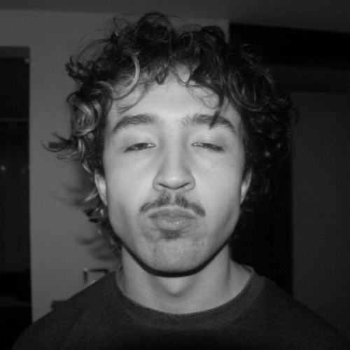
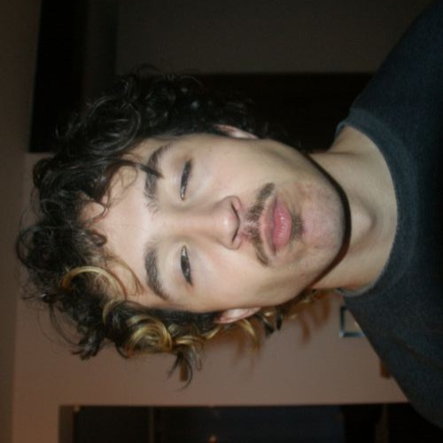
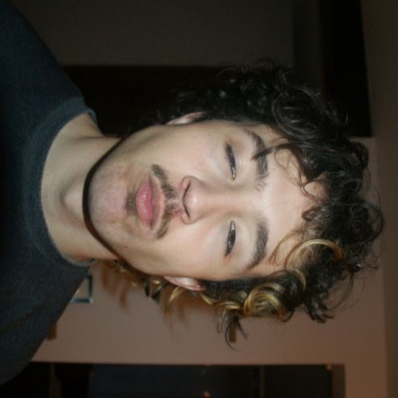
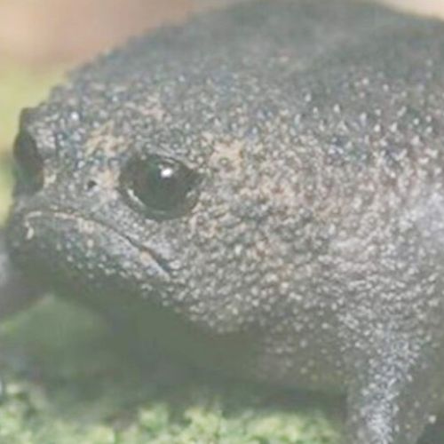
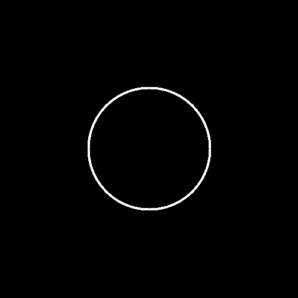
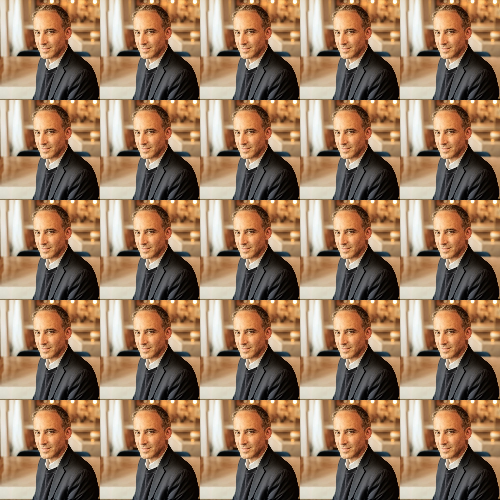
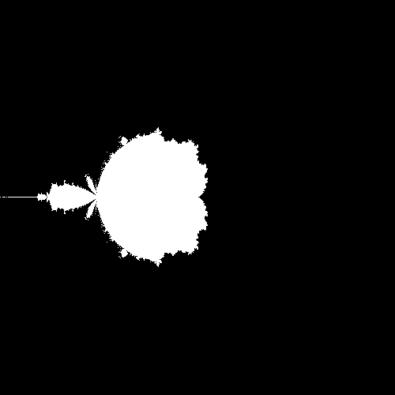
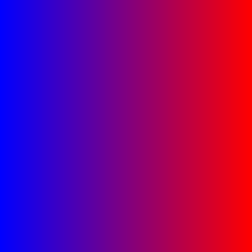
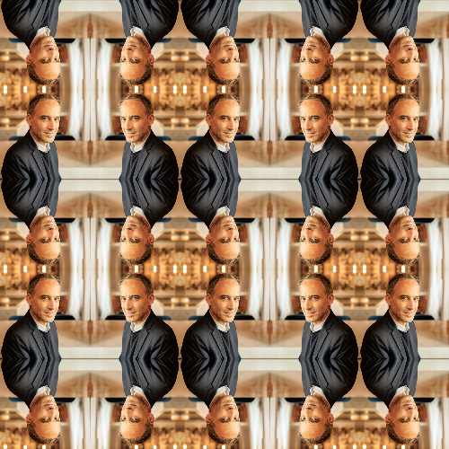

# 🐣 S1 | Prog: Workshop


## Exercices ⭐:

**Ne garder que le vert**


**Channel swap**


**Black and white**



**Negative**


**Gradient**


## Exercices ⭐⭐:

**Mirror**


**Noise**


**Rotation**



J'ai eu un petit problème avec la rotation, puisque mon image était inversée avant d'être à 90°, ce qui me donnait quelque chose comme ça:



Mon programme ne fonctionnait pas car mes pixels de coordonnées x=y ne changeaient pas de place. J'ai donc transformé mon code passant de cette version:

```cpp
image.pixel(y,x)=seb.pixel(x,y);
```

à celle-ci:

```cpp
image.pixel(image.height()-y-1,x)=seb.pixel(x,y);
```

**RGB split**


**Lighter**



**Darker**


**Disc**


**Circle**



**Animation**


**Mosaic**



## Exercices ⭐⭐⭐:

**Rosace**


**Glitch**


**Fractale**



**Colored gradient**



## Exercices ⭐⭐⭐⭐:

**Mosaic mirror**



**Vortex**