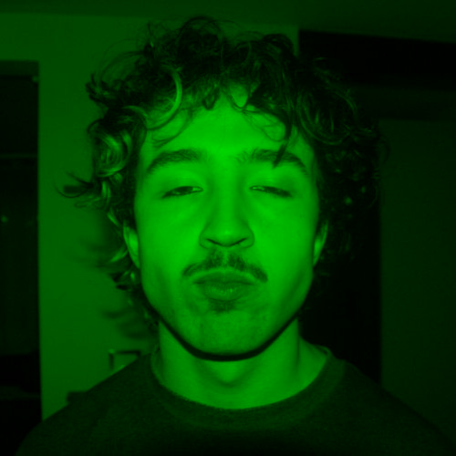
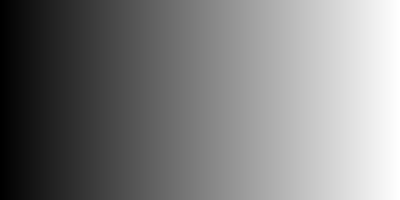
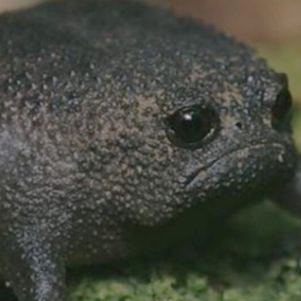
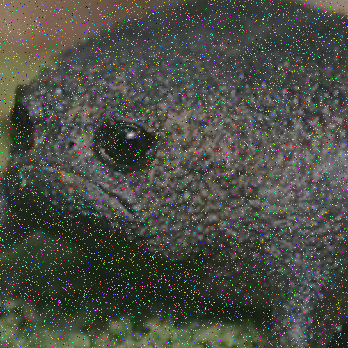
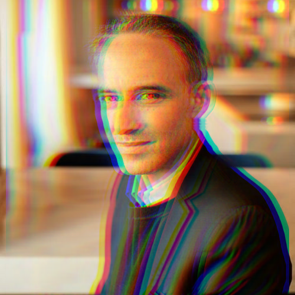
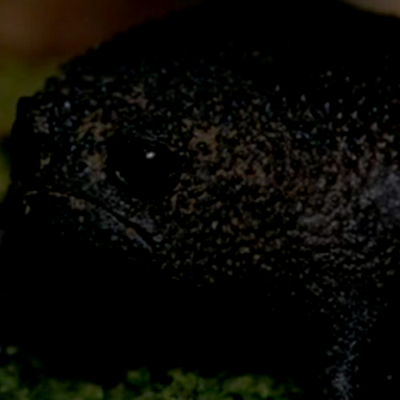
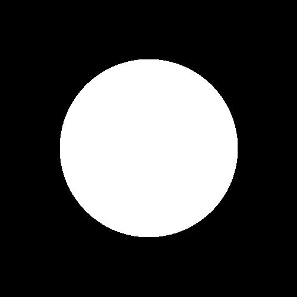
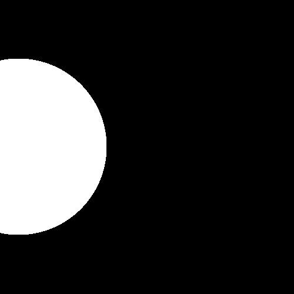
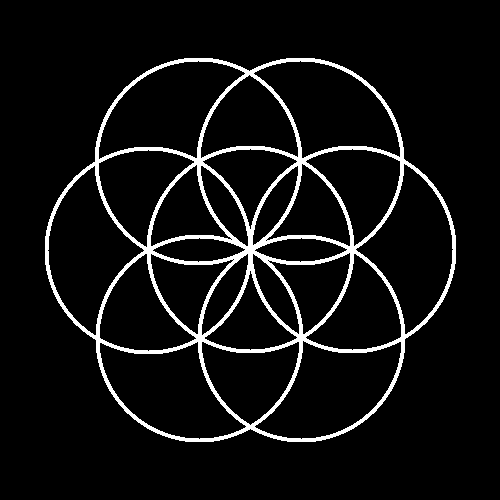
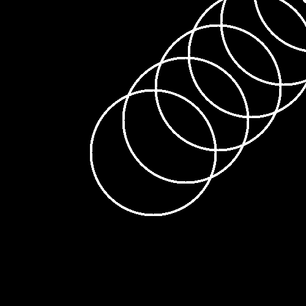

# 🐣 S1 | Prog: Workshop


## Exercices ⭐:

**Ne garder que le vert**



**Channel swap**


**Black and white**


**Negative**


**Gradient**



## Exercices ⭐⭐:

**Mirror**



**Noise**



**Rotation**


J'ai eu un petit problème avec la rotation, puisque mon image était inversée avant d'être à 90°, ce qui me donnait quelque chose comme ça:


Mon programme ne fonctionnait pas car mes pixels de coordonnées x=y ne changeaient pas de place. J'ai donc transformé mon code passant de cette version:

```cpp
image.pixel(y,x)=seb.pixel(x,y);
```

à celle-ci:

```cpp
image.pixel(image.height()-y-1,x)=seb.pixel(x,y);
```

**RGB split**



Shoutout to Raphaël Glucksmann

**Lighter**


**Darker**



**Disc**



J'ai eu beaucoup de mal avec cet exercice. Je n'arrivait pas à comprendre comment déplacer le centre de mon cercle (surtout que j'ai eu des petits bugs avec vscode qui m'ont perturbés hihi). Mais j'ai juste compris après quelques explications qu'il suffisait de "déplacer l'image autour du x" en lui soustrayant la largeur de l'image divisée par deux (idem avec le y et la longueur).

**Circle**


Pas très compliqué après avoir fait le disque, j'ai juste ajouté les paramètres xtranslate et ytranslate afin de faire ma rosace.

**Animation**



**Mosaic**


Au début, mes images rétrécies se mettaient au même endroit (coin inférieur gauche). J'ai donc utilisé deux autres variables, i et j pour résoudre ce problème. Il y avait apparemment une version plus optimisée mais je ne l'ai pas bien comprise donc j'ai gardé mon code moche.


## Exercices ⭐⭐⭐:

**Rosace**



J'ai cru que j'allais casser mon pc alors que c'était pas si compliqué mais j'avais oublié toute la trigo. J'avais commencé par faire les trois cercles alignés sur l'axe des abscisses avant de comprendre qu'il suffisait de faire une formule qui faisait des cercles en fonction de leur centre. 

Une fois ma fonction cercle modifiée, je ne comprenais pas comment faire pour que mes cercles "tournent" autour de celui au centre. Je me retrouvait avec cette figure:



J'ai ensuite compris qu'il fallait utiliser les cosinus et sinus et tout a bien fini !

**Glitch**


J'ai eu un peu de mal pour trouver comment faire pour récupérer des rectangles de taille et de position aléatoire, j'ai donc dû créer pas mal de variables. Je ne sais pas si j'aurai pu optimiser mon code mais je n'ai pas trouvé comment.

La manière la plus simple que j'ai trouvé a été de créer des variables randomx et randomy pour l'image d'origine et x et y pour la copie afin de créer des rectangles.

Lorsque le j dépendait d'un nombre aléatoire, la hauteur du rectangle était toujours la même puisqu'il était à l'intérieur d'une boucle. J'ai donc initialisé une variable a en dehors des deux boucles for pour obtenir des rectangles de hauteur différentes.

**Fractale**


Je n'ai pas vraiment eu de problèmes avec la fractale mais je n'ai pas réussi à la rendre plus jolie T-T

**Colored gradient**

Pareil pour le gradient coloré, les maths étaient effrayantes.


## Exercices ⭐⭐⭐⭐:

**Mosaic mirror**


Désolée le code est immonde mais au moins il marche :D